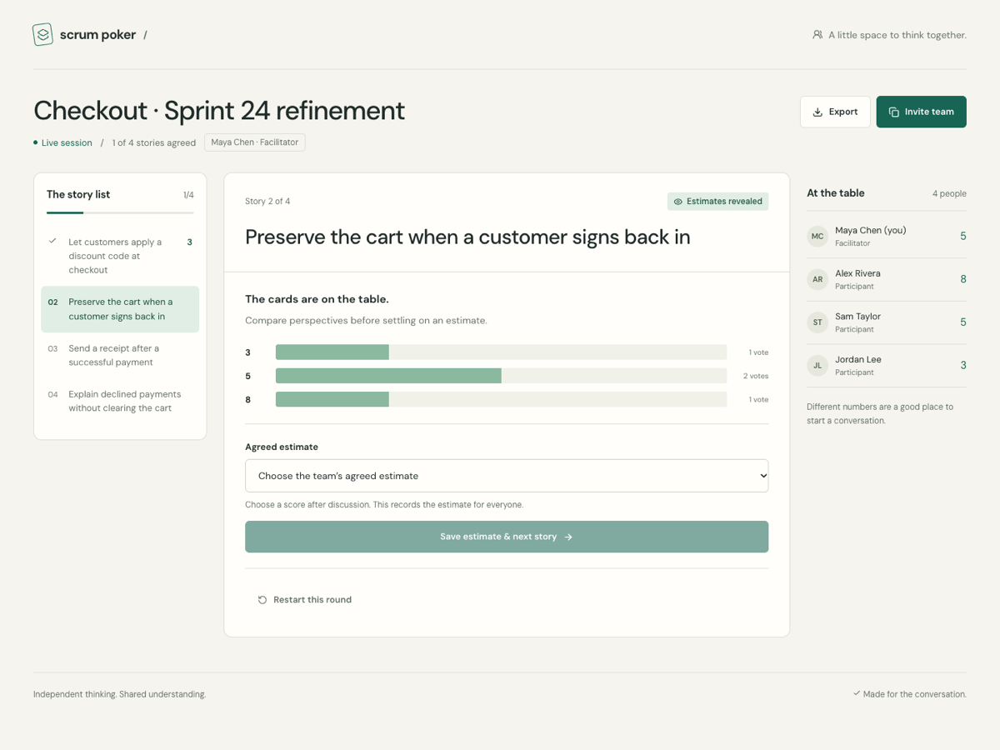

# Scrum Poker

**Independent thinking. Shared understanding.**

A calm, shared worksheet for team estimation. Bring a story list, invite your team, and vote privately—including the facilitator. Reveal the cards, discuss the differences, and record an agreed score before moving on.

[Quickstart](#quickstart) · [How it works](#how-it-works) · [Deployment](#deployment) · [Development](#development) · [Security](SECURITY.md)


<sub>The actual worksheet during a browser check, with synthetic review names and stories.</sub>

## Quickstart

You need **[Bun 1.4.2 or newer](https://bun.sh)**. SQLite is built into Bun; there is no separate database service or account setup.

```sh
bun install --frozen-lockfile
```

Run the API and web app in separate terminals:

| Terminal | Command | Address |
| --- | --- | --- |
| API · watch mode | `bun run dev` | `http://127.0.0.1:3001` |
| Web · hot reload | `bun run dev:web` | **`http://localhost:5173`** |

Open **http://localhost:5173**, create a session, and invite your team using the room link. Vite proxies `/api` to Bun. Keep this development setup private; use the production setup below for a shared deployment.

> The facilitator identity stays in the creator’s browser storage. A room link lets someone **join**, not take over the room. Use a separate browser profile or private window to try a second participant; tabs in the same profile share their identity.

## How it works

**Create → invite → vote → reveal → agree → next story.**

1. **Set the table.** Enter your name, name the session, and paste one story per line.
2. **Think independently.** Everyone can submit or change an estimate until reveal. The roster shows who has voted, never their number—even to the facilitator.
3. **Compare perspectives.** The facilitator reveals the estimates. An explicit confirmation makes early reveal deliberate when someone has not voted.
4. **Agree and move on.** Choose the team’s final score, save it, and advance. Restart the round if another private vote would help.
5. **Take the results.** Export story titles and agreed scores as CSV, with spreadsheet formula prefixes neutralized.

The deck is **0 · ½ · 1 · 2 · 3 · 5 · 8 · 13 · 21 · ?**. The question mark is a valid vote, not a final score.

### Built for a real conversation

- **One room for both roles:** shared voting, story progress, presence, revealed distribution, and role-specific facilitator controls.
- **Live, not noisy:** authenticated server-sent snapshots; polling only while disconnected, automatic reconnect, and stale-update protection.
- **Durable decisions:** SQLite commits accepted commands before sending success or updates. Reloading restores the saved room identity when browser storage is available.
- **Useful on a small screen:** the active story comes first on mobile, with native controls, keyboard focus, and reduced-motion support.

## Deployment

Build the web app, then run **one Bun process** to serve the SPA and API on the same origin:

```sh
bun install --frozen-lockfile
bun run build
PUBLIC_ORIGIN=https://planning.example.com \
  DATABASE_PATH=/var/lib/scrum-poker/rooms.sqlite \
  HOST=127.0.0.1 PORT=3001 bun start
```

Put an HTTPS reverse proxy in front of the listener and set `PUBLIC_ORIGIN` to the exact external origin. Preserve SSE streaming: disable buffering for `/api/rooms/*/events` and allow idle connections longer than the 15-second heartbeat. Bind `HOST=0.0.0.0` only when your container or network topology requires it. The Vite development server is not a production server.

| Variable | Default | Purpose |
| --- | --- | --- |
| `HOST` | `127.0.0.1` | Listener bind address |
| `PORT` | `3001` | HTTP port |
| `PUBLIC_ORIGIN` | Request origin | Exact permitted browser origin, including scheme and port; set explicitly behind a proxy |
| `DATABASE_PATH` | `.data/scrum-poker.sqlite` | Private SQLite file, outside the served `dist` directory |

### Persistence and security

Keep the database on a **persistent, local writable volume**. SQLite uses WAL and full synchronous transactions. Presence and stream fan-out are process-local: multiple workers or horizontal replicas are not supported.

Use SQLite’s online backup mechanism, or stop the app before copying database files. Copying only an actively written main file can miss its WAL. Protect database, WAL/SHM files, and backups: room content and individual estimates are not encrypted at rest.

Room access uses per-person bearer capabilities, stored as hashes on the server and retained in browser localStorage. Names are not verified identities. Losing browser storage loses access; there is no facilitator recovery or transfer. Never put capabilities in URLs or logs. The server applies same-origin checks, bounded requests/streams, restricted static serving, and a self-only CSP; add edge limits and proxy timeouts for public deployments.

Read **[SECURITY.md](SECURITY.md)** for the threat boundary, rate limits, backup guidance, and private reporting instructions.

## Development

### Checks

```sh
bun run test         # Backend + frontend regression suites
bun run test:server  # Bun HTTP/SSE, state, persistence, privacy, authorization
bun run test:ui      # Vitest + Testing Library: forms, room controls, reconnect, CSV
bun run typecheck    # Client, server, shared types, and tests
bun run build        # Production Vite bundle
bun run audit        # Current dependency advisories
```

Automated tests are regression checks, not a security certification. Browser workflow and responsive checks are separate from unit tests.

### Stack and structure

**React 19 · TypeScript · Vite 8 · Bun · Hono · SQLite · Zod**

Self-hosted DM Sans and Lucide icons form the frontend’s visual layer. Vitest, React Testing Library, and Bun’s test runner cover the application.

| Path | Responsibility |
| --- | --- |
| `src/` | Worksheet UI, typed room hook, authenticated streaming, browser identity storage, safe CSV export |
| `server/service.ts` | Authoritative state machine, transactional SQLite, capability hashes, per-viewer snapshots, multi-tab presence |
| `server/app.ts` | HTTP/SSE API, validation, origin policy, resource limits, response headers, static serving |
| `server/index.ts` | Listener, private persistence permissions, expiry sweep, shutdown |
| `shared/types.ts` | Public protocol and estimate deck |
| `tests/server.test.ts`, `src/*.test.tsx` | Backend/security and frontend regression suites |
| `public/` | Same-origin SVG, ICO, and touch-icon assets copied into the production build |

The backend owns every transition: **voting → revealed → finalize → next story / completed**. Commands carry the current round ID and revision. A stale action refreshes the worksheet and asks the user to retry; it is never silently replayed. Before reveal, HTTP and SSE omit everyone else’s estimate.

[API contract](API-CONTRACT.md) · [Product behavior](PRODUCT.md) · [Design system](DESIGN.md)

## Honest limits

- **Seven days per room**, measured from creation. Existing members can revisit completed rooms until expiry; completed rooms reject new joins.
- **100 stories**, 500 characters per story, **50 people** per room; names up to 60 characters and titles up to 120. The server stores at most 10,000 rooms.
- **64 KiB** request bodies; at most 5 streams per person, 160 per room, and 2,000 server-wide, plus bounded request rates.
- No accounts, verified names, identity recovery, facilitator transfer, participant removal, or story editing after creation.
- No external integrations or retained individual-vote history. CSV contains finalized scores, not private per-person estimates.
